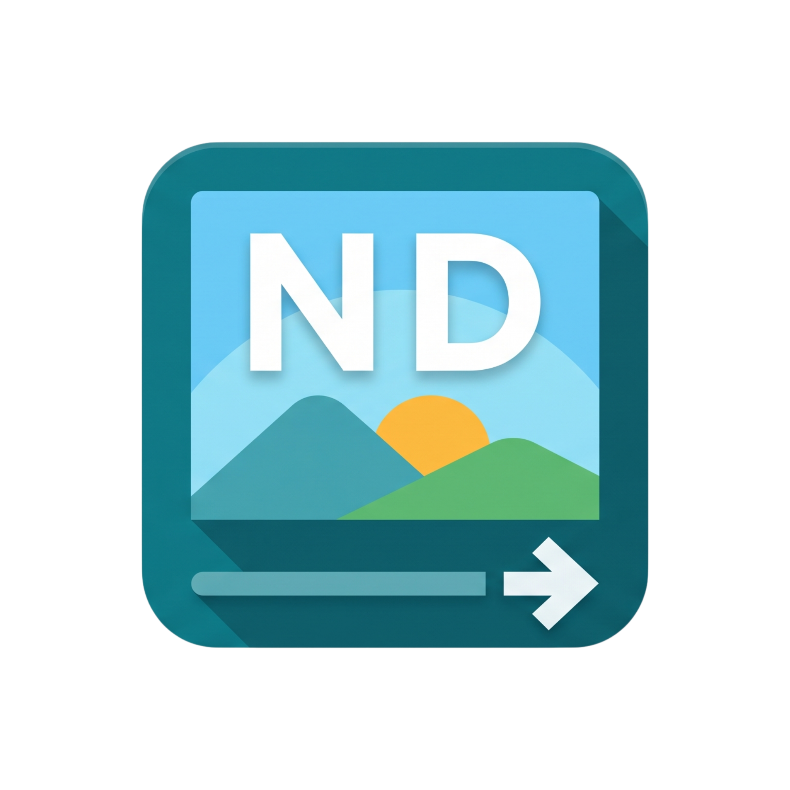

# ND Image Converter

**Blazing-fast, privacy-first, offline batch image converter & optimizer for desktop.**


---

<p align="center">
  
</p>

<p align="center">
  <a href="https://duongtruongdp.net/NDImgConverter_download">
    
  </a>
</p>

---

## ⚡ Quick Download & Install

No terminal or programming tools required. Use the stable download page to choose the installer for your platform:

| Platform | Installer | Architecture | Download Link |
| :--- | :--- | :--- | :--- |
| **macOS** | `.dmg` | Apple Silicon (M1/M2/M3/M4) | [Download for Mac](https://duongtruongdp.net/NDImgConverter_download) |
| **macOS** | `.dmg` | Intel | [Download for Mac](https://duongtruongdp.net/NDImgConverter_download) |
| **Windows** | `.exe` | x64 (64-bit) | [Download for Windows](https://duongtruongdp.net/NDImgConverter_download) |

The page recommends a likely match when the browser can identify the operating system, while always keeping manual choices available. Linux installers are not advertised until a verified Linux package is built for this release.

### First-Time Launch Instructions

* **macOS (first launch):**
  * Drag `ND Image Converter` into your `/Applications` folder.
  * These v0.9.0 packages are not notarized. Verify the release checksum, then use Finder's **Open** action if Gatekeeper asks for confirmation.
* **Windows (SmartScreen warning):**
  * Verify the release checksum. If SmartScreen asks for confirmation, review the publisher and choose whether to continue; do not disable SmartScreen globally.

---

## 🌟 Overview

**ND Image Converter** is a high-throughput desktop utility designed for photographers, creators, and developers who need instant image format conversions without cloud uploads or privacy compromises.

Built with **Tauri 2**, **React**, and a multi-threaded **Rust processing engine**, all processing happens 100% locally on your hardware.

---

## ✨ Key Features

### Image conversion and optimization

- 🔒 **Privacy-first local processing:** Image and video conversion stays on the computer; the optional downloader connects only when you ask it to fetch an online media URL.
- ⚡ **Fast native engine:** Rust-based processing with `rayon` parallelism for responsive batch conversion.
- 🖼 **Broad format support:** Convert common formats such as JPEG, PNG, WebP, AVIF, BMP, ICO, TIFF, TGA, GIF, EXR, and more.
- 📷 **Camera RAW and DNG support:** Decode CR2, CR3, DNG, ARW, NEF, ORF, RAF, and other RAW formats through native demosaicing and embedded-preview handling.
- 📱 **HEIC/HEIF support:** Import and convert modern phone-camera images locally.
- 🎯 **Flexible resizing:** Preserve original dimensions, resize by target width with aspect-ratio preservation, or scale by percentage.
- 🎚 **Quality and size estimation:** Adjust output quality and preview estimated output size before processing.
- 🎨 **Color management:** Optional ICC color transformations using LittleCMS 2, including sRGB, Display P3, Adobe RGB, and Rec.709 workflows.
- 🛡 **Metadata privacy controls:** Strip EXIF metadata, GPS coordinates, thumbnails, and other embedded metadata during export.
- 🖋 **Watermark engine:** Add text or logo watermarks with configurable position, scale, opacity, and automatic image scaling.
- 👁 **Before/after inspection:** Compare source and converted results with an interactive split-view preview.

### Video tools

- 🎞 **Video to GIF:** Convert H.264/H.265 MP4, MOV, MKV, WebM, AVI, and M4V videos into GIF locally.
- ✂️ **Editor-style trim timeline:** Set in/out points by dragging timeline handles, use the integrated playback controls, or edit exact time values.
- 🎛 **GIF export controls:** Configure output width, FPS, and quality with palette generation for better color results.
- 🔁 **Video format converter:** Convert between MP4, MOV, MKV, and WebM containers with selectable H.264, H.265, VP8, VP9, and AV1 codecs.
- 🔊 **Audio preservation:** Choose whether to retain the source audio track during video conversion.
- 📦 **Bundled FFmpeg runtime:** Release builds include the required FFmpeg and FFprobe runtime files for offline video processing.
- 🖱 **Native drag and drop:** Drop image, folder, or video files directly into the relevant workspace.
- 🖼 **Grab Stills:** Scrub local video timestamps and extract JPEG, PNG, or WEBP still frames.

### Workflow and desktop experience

- 📂 **Batch and recursive folder processing:** Add multiple files or nested directories and process them in one operation.
- 👀 **Watch folder automation:** Monitor an input directory and route new image and video files using separate editable profiles.
- 🔄 **Persistent tab sessions:** Keep queued files, video positions, trim points, and Watch Folder configuration while switching tabs.
- 📁 **Native output-folder selection:** Choose an output directory through the operating system picker; defaults to the input folder.
- 🔔 **GitHub release update checker:** Detect newer versions and open the matching macOS or Windows installer when it is available.
- 🌐 **Video Downloader:** Analyze and download authorized public video URLs with selectable formats, optional browser-cookie authentication, progress reporting, and a bundled pinned `yt-dlp` engine.
- 🛡 **YouTube stream support:** Release builds include the pinned `bgutil-ytdlp-pot-provider-rs` plugin/provider for YouTube PO Token requests when supported by the source.
- 🖥 **Cross-platform desktop app:** Built with Tauri for macOS, Windows, and Linux with a lightweight native shell.
- 🌙 **Dark and Light UI:** Consistent semantic controls, previews, progress feedback, and conversion status reporting.

---

## 🛠 Tech Stack

* **Desktop Framework:** [Tauri 2](https://tauri.app/)
* **Core Processing Engine:** [Rust](https://www.rust-lang.org/) (`image`, `rayon`, `webp`, `tokio`, `lcms2`)
* **Frontend:** [React](https://react.dev/) + [TypeScript](https://www.typescriptlang.org/) + [Vite](https://vitejs.dev/)
* **Styling:** [Tailwind CSS](https://tailwindcss.com/)
* **State Management:** [Zustand](https://github.com/pmndrs/zustand)
* **Icons:** [Lucide React](https://lucide.dev/)

The optional YouTube PO Token integration packages the provider's GPLv3 plugin and standalone Rust binary in release builds. See the provider's [license and source](https://github.com/jim60105/bgutil-ytdlp-pot-provider-rs) for attribution and redistribution terms.

---

## 👨‍💻 Development & Building from Source

If you want to contribute or build the application from source code:

### Prerequisites

* [Node.js](https://nodejs.org/) (v18.0 or newer)
* [Rust & Cargo](https://rustup.rs/) (stable toolchain)
* **macOS:** Xcode Command Line Tools (`xcode-select --install`)
* **Windows:** Visual Studio C++ Build Tools (with *Desktop development with C++*)

### Local Setup

### 1. Clone repository
```
git clone [https://github.com/duongtruongdp/ND-ImgConverter.git](https://github.com/duongtruongdp/ND-ImgConverter.git)
cd ND-ImgConverter
```

### 2. Install dependencies
```
npm install
```

### 3. Start development environment
```
npm run tauri dev
```

### 4. Packaging production release
```
npm run tauri build
```
The output installation files will be generated in:
- macOS: src-tauri/target/release/bundle/dmg/
- Windows: src-tauri/target/release/bundle/nsis/

For repository and contributor guidance, see [AGENTS.md](AGENTS.md).


## 🛠️ Troubleshooting

### Q&A

**Question**: Why does macOS show a Gatekeeper warning?
Unsigned test builds may be blocked when first downloaded. Verify the release checksum, then right-click the app in Finder and choose **Open**, or go to **System Settings -> Privacy & Security -> Open Anyway**. Production signed and notarized releases should not require an override.

**Question**: Why does Windows show "Windows protected your PC"?
This SmartScreen warning appears because ND Image Converter isn't code-signed yet. Code signing certificates cost $400+/year, which isn't feasible for a free project at this stage.

To install safely:

- Click "More info" on the warning dialog
- Click "Run anyway"
ND Image Converter is free and privacy-first. Core image/video conversion runs locally; verify every release checksum before installing.


## 🗺 Roadmap
- [x] **v0.1** — Core Engine, Batch Conversion, Fast Thumbnails, Native Drag & Drop.
- [x] **v0.2** — Before/After Comparison Slider, Presets Manager, Keyboard Shortcuts.
- [x] **v0.3** — Expanded input/output format support and dark minimalist UI.
- [x] **v0.4** — Watch Folder Automation, ICC Color Management, Output Size Estimation, Pixel-Level Comparison.
- [x] **v0.5** — GitHub Update Checker, HEIC Fast-Path Optimization, Installer Branding.
- [x] **v0.6** — Watermark Engine, EXIF Stripper, Linux Build Pipeline.
- [x] **v0.7** — Video workflows: Video to GIF and core video conversion.
- [x] **v0.8** — PDF/EXR fixes, Light Theme, VFR→CFR, multi-video conversion, Watch Folder profiles, Grab Stills.
- [x] **v0.9** — Online Video Downloader, queue workflows and downloader hardening/compatibility.
- [ ] **v1.0** — Stable milestone with full cross-platform parity and production hardening.


## 📄 License
This project is licensed under the MIT License - see the LICENSE file for details.
